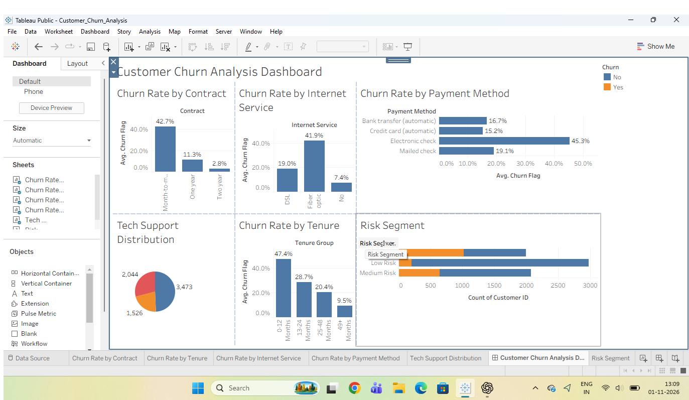

# Customer Churn Analysis

## Project Overview
This project analyzes customer churn data to identify factors that influence customer churn and customer risk levels.

## Dataset
The dataset contains 7,043 customer records with information about:
- Contract type
- Internet service
- Payment method
- Tenure
- Tech support
- Churn status

## Analysis Performed
- Churn Rate by Contract
- Churn Rate by Internet Service
- Churn Rate by Payment Method
- Churn Rate by Tenure
- Tech Support Distribution
- Customer Risk Segment

## Key Findings
- Month-to-month customers have a higher churn rate than customers with longer contracts.
- Customers using fiber optic internet show a higher churn rate.
- Electronic check users have a higher churn rate among the payment methods analyzed.
- Customers with shorter tenure show higher churn rates.
- Customers were categorized into Low, Medium, and High Risk segments.

## Tools Used
- Python
- Pandas
- Tableau
- Excel

## Dashboard
The Tableau dashboard provides an interactive view of customer churn patterns and risk segments.

### Tableau Dashboard Preview

